# Entity-relationship diagram

Generated from the live database by `scripts/erd.py` — it always matches the migrations.
Entities are named `schema_table`. Audit tables deliberately have no foreign keys: the ledger must outlive what it mentions.

```mermaid
erDiagram
  iam_users ||--o{ alerts_alerts : "acknowledged_by"
  iam_signing_keys ||--o{ audit_checkpoints : "signing_key_id"
  cases_cases ||--o{ cases_case_members : "case_id"
  iam_users ||--o{ cases_case_members : "added_by"
  iam_users ||--o{ cases_cases : "created_by"
  org_units ||--o{ cases_cases : "unit_id"
  cases_cases ||--o{ collab_requests : "case_id"
  docs_documents ||--o{ collab_requests : "document_id"
  docs_versions ||--o{ collab_requests : "version_id"
  iam_users ||--o{ collab_requests : "assigned_to"
  collab_requests ||--o{ collab_shares : "request_id"
  docs_documents ||--o{ collab_shares : "document_id"
  iam_users ||--o{ collab_shares : "approved_by"
  iam_users ||--o{ demo_personas : "user_id"
  docs_derivatives ||--o{ docs_certificates : "pdf_derivative_id"
  docs_versions ||--o{ docs_certificates : "version_id"
  iam_signing_keys ||--o{ docs_certificates : "signing_key_id"
  iam_users ||--o{ docs_certificates : "issued_by"
  docs_versions ||--o{ docs_derivatives : "source_version_id"
  iam_users ||--o{ docs_derivatives : "created_by"
  cases_cases ||--o{ docs_documents : "case_id"
  docs_versions ||--o{ docs_documents : "current_version_fk"
  iam_users ||--o{ docs_documents : "created_by"
  docs_versions ||--o{ docs_entities : "version_id"
  docs_versions ||--o{ docs_processing_steps : "version_id"
  docs_documents ||--o{ docs_text_index : "document_id"
  docs_versions ||--o{ docs_text_index : "version_id"
  docs_documents ||--o{ docs_versions : "document_id"
  iam_signing_keys ||--o{ docs_versions : "signing_key_id"
  iam_users ||--o{ docs_versions : "uploaded_by"
  iam_users ||--o{ iam_activation_codes : "issued_by"
  iam_users ||--o{ iam_face_templates : "user_id"
  iam_permissions ||--o{ iam_role_permissions : "permission_code"
  iam_roles ||--o{ iam_role_permissions : "role_code"
  iam_users ||--o{ iam_sessions : "user_id"
  iam_users ||--o{ iam_totp_credentials : "user_id"
  iam_roles ||--o{ iam_users : "role_code"
  org_units ||--o{ iam_users : "unit_id"
  alerts_alerts {
    uuid id
    text type
    text severity
    text title
    text message
    uuid case_id
    uuid document_id
    uuid actor_user_id
    bigint audit_seq
    text status
    uuid acknowledged_by
    timestamptz acknowledged_at
    uuid resolved_by
    timestamptz resolved_at
    text resolution_note
    timestamptz created_at
  }
  audit_checkpoints {
    bigint id
    bigint from_seq
    bigint to_seq
    character head_hash
    character merkle_root
    integer event_count
    timestamptz created_at
    bytea signature
    text signing_key_id
    text sealed_path
  }
  audit_events {
    bigint seq
    uuid id
    timestamptz occurred_at
    uuid actor_user_id
    text actor_role
    text actor_service_id
    text ip
    text user_agent
    text action
    text outcome
    text reason_code
    uuid case_id
    uuid document_id
    uuid version_id
    uuid target_user_id
    uuid request_id
    text purpose
    text summary
    jsonb details
    character prev_hash
    character event_hash
  }
  cases_case_members {
    uuid id
    uuid case_id
    uuid user_id
    text capacity
    uuid added_by
    timestamptz added_at
    timestamptz expires_at
    uuid removed_by
    timestamptz removed_at
    text removal_reason
  }
  cases_cases {
    uuid id
    text case_number
    text fir_number
    date fir_date
    uuid unit_id
    text title
    text category
    text_array offence_sections
    text status
    boolean is_victim_protected
    text victim_pseudonym
    bytea victim_identifiers_enc
    text default_sensitivity
    uuid lead_io_id
    text court_name
    date next_hearing_date
    text description
    uuid created_by
    timestamptz created_at
    timestamptz updated_at
    timestamptz closed_at
  }
  collab_requests {
    uuid id
    text type
    text status
    uuid case_id
    uuid document_id
    uuid version_id
    uuid requested_by
    uuid assigned_to
    jsonb payload
    text reason
    uuid decided_by
    timestamptz decided_at
    text decision_note
    timestamptz created_at
  }
  collab_shares {
    uuid id
    uuid document_id
    uuid grantee_user_id
    text scope
    timestamptz expires_at
    uuid request_id
    uuid created_by
    uuid approved_by
    timestamptz created_at
    uuid revoked_by
    timestamptz revoked_at
    text revoke_reason
  }
  demo_personas {
    uuid user_id
    smallint sort
    text headline
    text shows
    text activation_code
  }
  docs_certificates {
    uuid id
    text cert_number
    uuid version_id
    text verification_code
    character sha256
    jsonb part_a
    jsonb part_b
    text signatory_name
    text signatory_designation
    text purpose
    uuid pdf_derivative_id
    bytea signature
    text signing_key_id
    text status
    text revoked_reason
    timestamptz revoked_at
    uuid issued_by
    timestamptz issued_at
  }
  docs_derivatives {
    uuid id
    uuid source_version_id
    text kind
    text status
    text mime
    text storage_key
    character sha256
    bytea enc_nonce
    bytea wrapped_dek
    text kek_id
    jsonb summary
    uuid created_by
    timestamptz created_at
  }
  docs_documents {
    uuid id
    text doc_number
    uuid case_id
    text title
    text doc_type
    text sensitivity
    text retention_state
    text legal_hold_reason
    uuid legal_hold_by
    timestamptz legal_hold_at
    text status
    text withdrawn_reason
    uuid withdrawn_by
    timestamptz withdrawn_at
    uuid custodian_id
    uuid current_version_id
    text_array tags
    uuid created_by
    timestamptz created_at
    timestamptz updated_at
  }
  docs_entities {
    bigint id
    uuid version_id
    text type
    text value
    integer page_no
    boolean is_pii
    boolean is_victim_identifier
    real confidence
    text source
  }
  docs_processing_steps {
    bigint id
    uuid version_id
    text step
    smallint seq
    text status
    boolean critical
    timestamptz started_at
    timestamptz finished_at
    jsonb detail
  }
  docs_text_index {
    bigint id
    uuid version_id
    uuid document_id
    integer page_no
    boolean redacted
    text body
    tsvector tsv
  }
  docs_versions {
    uuid id
    uuid document_id
    integer version_no
    uuid parent_version_id
    text change_note
    text original_filename
    text detected_mime
    bigint size_bytes
    character sha256
    character client_sha256
    character prev_version_sha256
    character ciphertext_sha256
    text storage_key
    bytea enc_nonce
    bytea wrapped_dek
    text kek_id
    jsonb manifest
    character manifest_sha256
    bytea signature
    text signing_key_id
    text processing_status
    text scan_result
    text scan_detail
    integer page_count
    text ocr_status
    text review_status
    timestamptz retain_until
    uuid uploaded_by
    timestamptz uploaded_at
    timestamptz last_verified_at
    text last_verification
  }
  iam_face_templates {
    uuid id
    uuid user_id
    text model
    smallint dims
    smallint samples
    real quality
    timestamptz enrolled_at
    timestamptz revoked_at
  }
  iam_permissions {
    text code
    text description
  }
  iam_role_permissions {
    text role_code
    text permission_code
  }
  iam_roles {
    text code
    text title
    text description
    smallint tier
    boolean is_administrative
    boolean sees_case_content
  }
  iam_sessions {
    uuid id
    uuid user_id
    text first_factor
    timestamptz created_at
    timestamptz expires_at
    timestamptz last_seen_at
    timestamptz revoked_at
    text ip
    text user_agent
  }
  iam_signing_keys {
    text kid
    text purpose
    text algorithm
    bytea public_key
    timestamptz created_at
    timestamptz retired_at
  }
  iam_users {
    uuid id
    text service_id
    text full_name
    text rank
    text role_code
    uuid unit_id
    citext email
    text phone
    text status
    timestamptz activated_at
    timestamptz last_login_at
    uuid created_by
    timestamptz created_at
  }
  org_units {
    uuid id
    text code
    text name
    text type
    uuid parent_id
    text district
    text state
  }
```

