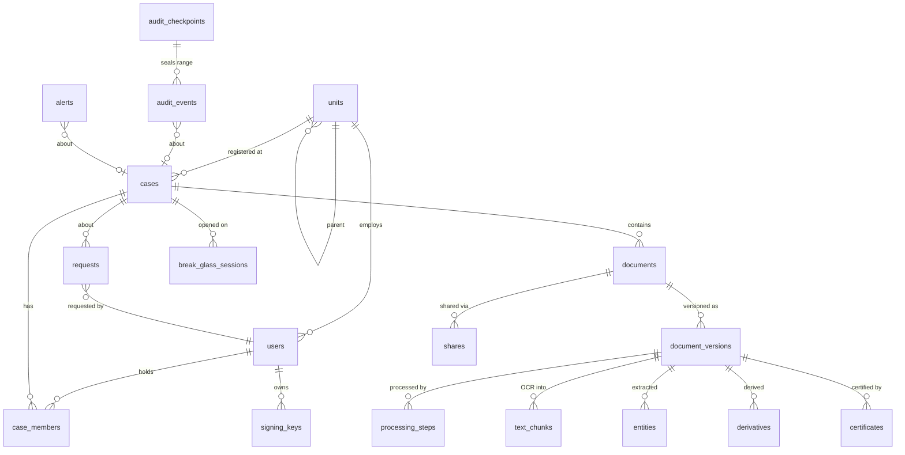

# 02 · Data Model

> **Implemented:** the live schema is the SQL in [`database/migrations/`](../database/migrations/) (8 schemas,
> roles, triggers, grants) — see [database/README.md](../database/README.md) and the generated
> [ERD](../database/ERD.md). This page is the original design; where they differ, the migrations win.

PostgreSQL 16 + extensions `pgcrypto`, `pg_trgm`, `vector` (stretch).
All IDs are UUIDv7 (time-ordered) unless noted. All timestamps are `timestamptz`, stored UTC,
displayed IST. Nothing is hard-deleted.

## ER overview



## Tables

### `units` — organisational hierarchy
| Column | Type | Notes |
|---|---|---|
| id | uuid PK | |
| code | text unique | `NV-PS-SHN` |
| name | text | "Shantinagar Police Station" |
| type | enum `unit_type` | `STATE_HQ`, `DISTRICT_HQ`, `POLICE_STATION`, `FSL`, `PROSECUTION_OFFICE`, `NCRB_CELL` |
| parent_id | uuid FK units | null for root |
| district, state | text | |

### `users`
| Column | Type | Notes |
|---|---|---|
| id | uuid PK | |
| service_id | text unique | login ID, e.g. `NV-IO-1045` |
| full_name | text | |
| rank | text | "Sub-Inspector" |
| role | enum `system_role` | `INVESTIGATOR`, `SUPERVISOR`, `PROSECUTOR`, `FORENSIC_EXPERT`, `AUDITOR`, `ADMIN` |
| unit_id | uuid FK units | |
| email, phone | text | phone shown masked |
| password_hash | text | argon2id |
| totp_secret_enc | bytea | encrypted under KEK |
| mfa_enabled | bool | must be true to use the app (except enrolment) |
| status | enum `user_status` | `ACTIVE`, `LOCKED`, `DISABLED` |
| failed_logins | int | lock at 5 for 15 min |
| locked_until | timestamptz | |
| last_login_at, created_at, updated_at | timestamptz | |

### `auth_sessions`
| Column | Type | Notes |
|---|---|---|
| id | uuid PK | refresh-token family |
| user_id | uuid FK | |
| refresh_token_hash | text | rotated on every refresh |
| mfa_verified_at | timestamptz | |
| step_up_at | timestamptz | last TOTP re-entry (for 🔐 obligations) |
| ip, user_agent | text | |
| created_at, expires_at, revoked_at | timestamptz | |

### `signing_keys`
| Column | Type | Notes |
|---|---|---|
| id | text PK | `kid`, e.g. `sys-manifest-2026-01` |
| owner_user_id | uuid FK null | null for system keys |
| purpose | enum | `MANIFEST`, `CHECKPOINT`, `CERTIFICATE`, `USER_ATTESTATION` (stretch) |
| algorithm | text | `Ed25519` |
| public_key | bytea | published at `/public/keys` |
| private_key_enc | bytea null | KEK-wrapped (prototype only; production → HSM / Vault) |
| created_at, retired_at | timestamptz | |

### `cases`
| Column | Type | Notes |
|---|---|---|
| id | uuid PK | |
| case_number | text unique | `NV/SHN/0142/2026` (state/station/FIR no/year) |
| fir_number | text | `0142/2026` |
| fir_date | date | |
| unit_id | uuid FK units | police station |
| title | text | short descriptive title — **never contains victim name** |
| category | enum `case_category` | `CRIME_AGAINST_WOMEN`, `CRIME_AGAINST_CHILDREN`, `CYBER`, `PROPERTY`, `BODILY_HARM`, `ECONOMIC`, `NARCOTICS`, `OTHER` |
| offence_sections | text[] | `{"BNS 74","BNS 78"}` |
| status | enum `case_status` | see lifecycle |
| is_victim_protected | bool | auto-true for women/children categories |
| victim_pseudonym | text null | `V-1` |
| default_sensitivity | enum `sensitivity` | |
| lead_io_id | uuid FK users | denormalised for listing |
| court_name | text null | |
| next_hearing_date | date null | |
| created_by, created_at, updated_at, closed_at | | |

**Case lifecycle**

```
REGISTERED → UNDER_INVESTIGATION → CHARGESHEET_FILED → UNDER_TRIAL → DISPOSED → CLOSED
                     └──────────→ FINAL_REPORT_FILED ──────────────────────────→ CLOSED
```

### `case_members`
| Column | Type | Notes |
|---|---|---|
| id | uuid PK | |
| case_id, user_id | uuid FK | unique active pair |
| capacity | enum `case_capacity` | `LEAD_IO`, `CO_IO`, `SUPERVISOR`, `PROSECUTOR`, `FORENSIC` |
| added_by, added_at | | |
| expires_at | timestamptz null | |
| removed_by, removed_at, removal_reason | | |

Constraint: exactly one active `LEAD_IO` per case (partial unique index).

### `documents` — the logical document
| Column | Type | Notes |
|---|---|---|
| id | uuid PK | |
| doc_number | text unique | `DOC-2026-000123` |
| case_id | uuid FK | |
| title | text | |
| doc_type | enum `doc_type` | `FIR`, `COMPLAINT`, `CASE_DIARY`, `WITNESS_STATEMENT`, `VICTIM_STATEMENT`, `ACCUSED_STATEMENT`, `SEIZURE_MEMO`, `ARREST_MEMO`, `MEDICAL_REPORT`, `FORENSIC_REPORT`, `PHOTO_EVIDENCE`, `CCTV_STILL`, `INVESTIGATION_REPORT`, `CHARGESHEET`, `COURT_FILING`, `COURT_ORDER`, `LEGAL_NOTICE`, `JUDGMENT`, `OTHER` |
| sensitivity | enum `sensitivity` | `INTERNAL`, `CONFIDENTIAL`, `RESTRICTED`, `VICTIM_PROTECTED` |
| retention_state | enum `retention_state` | `ACTIVE`, `LEGAL_HOLD`, `ARCHIVED` |
| legal_hold_reason, legal_hold_by, legal_hold_at | | |
| status | enum `document_status` | `ACTIVE`, `WITHDRAWN` |
| withdrawn_reason, withdrawn_by, withdrawn_at | | |
| custodian_id | uuid FK users | |
| current_version_id | uuid FK document_versions | latest READY version |
| tags | text[] | |
| created_by, created_at, updated_at | | |

### `document_versions` — one immutable upload
| Column | Type | Notes |
|---|---|---|
| id | uuid PK | |
| document_id | uuid FK | |
| version_no | int | 1, 2, 3 … unique per document |
| parent_version_id | uuid null | previous version |
| change_note | text | required for v ≥ 2 |
| original_filename | text | sanitised |
| detected_mime | text | from magic bytes, not the header |
| size_bytes | bigint | |
| sha256 | char(64) | of plaintext, computed by server |
| client_sha256 | char(64) | computed in browser; must equal `sha256` |
| prev_version_sha256 | char(64) null | links the version chain |
| ciphertext_sha256 | char(64) | of the stored object |
| storage_bucket, storage_key, storage_version_id | text | pinned S3 object version |
| object_lock_mode | enum | `GOVERNANCE` (demo) / `COMPLIANCE` (prod) |
| retain_until | timestamptz | |
| enc_alg | text | `AES-256-GCM` |
| enc_nonce | bytea(12) | |
| wrapped_dek | bytea | DEK encrypted under KEK |
| kek_id | text | for rotation |
| manifest | jsonb | canonical manifest (see 03) |
| manifest_sha256 | char(64) | |
| signature | bytea | Ed25519 over JCS(manifest) |
| signing_key_id | text FK signing_keys | |
| processing_status | enum `processing_status` | `RECEIVED`, `PROCESSING`, `READY`, `QUARANTINED`, `FAILED` |
| scan_result | enum | `PENDING`, `CLEAN`, `INFECTED`, `SKIPPED`, `ERROR` |
| scan_detail | text | signature name if infected |
| page_count | int null | |
| ocr_status | enum | `PENDING`, `DONE`, `NOT_APPLICABLE`, `FAILED` |
| ocr_languages | text | `eng+hin` |
| review_status | enum `review_status` | `NOT_REQUIRED`, `PENDING`, `APPROVED`, `RETURNED` |
| uploaded_by, uploaded_at | | |

The row is written once. After `READY`, only `review_status` may change (enforced by trigger).

### `processing_steps` — drives the live pipeline UI
| Column | Type | Notes |
|---|---|---|
| version_id | uuid FK | |
| step | enum | `RECEIVE`, `HASH_MATCH`, `VALIDATE`, `MALWARE_SCAN`, `ENCRYPT`, `STORE_WORM`, `SIGN_MANIFEST`, `AUDIT_ANCHOR`, `OCR`, `EXTRACT_ENTITIES`, `INDEX`, `EMBED` |
| seq | int | display order |
| status | enum | `PENDING`, `RUNNING`, `DONE`, `SKIPPED`, `FAILED` |
| started_at, finished_at | | |
| detail | jsonb | e.g. `{ "engine": "ClamAV 1.4", "result": "CLEAN" }` |

### `text_chunks` — OCR / extracted text
| Column | Type | Notes |
|---|---|---|
| id | bigserial PK | |
| version_id | uuid FK | |
| page_no, chunk_no | int | |
| text | text | |
| text_redacted | text | PII spans masked — served to redacted-only viewers |
| tsv | tsvector | GIN index, `simple` config (multilingual-safe) |
| embedding | vector(384) null | stretch |

Also: GIN `gin_trgm_ops` index on `text` for fuzzy search.

### `entities`
| Column | Type | Notes |
|---|---|---|
| id | bigserial PK | |
| version_id | uuid FK | |
| type | enum `entity_type` | `PERSON`, `DATE`, `LOCATION`, `ORGANISATION`, `LEGAL_SECTION`, `CASE_REFERENCE`, `VEHICLE_NUMBER`, `PHONE`, `AADHAAR`, `EMAIL`, `BANK_ACCOUNT`, `ADDRESS` |
| value | text | |
| page_no | int | |
| bbox | jsonb null | for redaction boxes on images/PDF pages |
| is_pii | bool | |
| is_victim_identifier | bool | flagged for VICTIM_PROTECTED redaction |
| confidence | real | |
| source | enum | `REGEX`, `NER`, `MANUAL` |

### `derivatives` — files generated from a version
| Column | Type | Notes |
|---|---|---|
| id | uuid PK | |
| source_version_id | uuid FK | |
| kind | enum | `REDACTED`, `CERTIFICATE_PDF`, `THUMBNAIL`, `OCR_PDF` |
| storage_key, storage_version_id | text | |
| sha256 | char(64) | |
| enc_nonce, wrapped_dek, kek_id | | encrypted like originals |
| summary | jsonb | e.g. `{ "redacted_spans": 14, "types": ["PERSON","PHONE"] }` |
| created_by, created_at | | |

### `shares`
| Column | Type | Notes |
|---|---|---|
| id | uuid PK | |
| document_id | uuid FK | |
| grantee_user_id | uuid FK | |
| scope | enum `share_scope` | `VIEW_REDACTED`, `VIEW`, `DOWNLOAD` |
| expires_at | timestamptz | required |
| request_id | uuid FK requests | the approval |
| created_by, created_at | | |
| revoked_by, revoked_at, revoke_reason | | |

### `requests` — one inbox for every approval
| Column | Type | Notes |
|---|---|---|
| id | uuid PK | |
| type | enum `request_type` | `SHARE`, `CUSTODY_TRANSFER`, `REVIEW`, `LEGAL_HOLD_RELEASE`, `MEMBERSHIP` |
| status | enum `request_status` | `PENDING`, `APPROVED`, `REJECTED`, `CANCELLED`, `EXPIRED` |
| case_id | uuid FK | |
| document_id, version_id | uuid null | |
| requested_by | uuid FK | |
| assigned_to | uuid null | specific approver (custody recipient) or null = any eligible supervisor |
| payload | jsonb | type-specific: `{grantee_user_id, scope, expires_at}` / `{to_user_id}` / … |
| reason | text | |
| decided_by, decided_at, decision_note | | |
| created_at | | |

### `break_glass_sessions`
| Column | Type | Notes |
|---|---|---|
| id | uuid PK | |
| user_id, case_id | uuid FK | |
| reason | text | ≥ 20 chars |
| started_at, expires_at | | 60 min |
| ended_at | | early close |
| review_outcome | enum null | `JUSTIFIED`, `UNJUSTIFIED` |
| reviewed_by, reviewed_at, review_note | | |

### `certificates` — BSA §63 certificate
| Column | Type | Notes |
|---|---|---|
| id | uuid PK | |
| cert_number | text unique | `CFV-63-2026-000045` |
| version_id | uuid FK | |
| verification_code | text unique | 12 chars, base32, in the QR |
| sha256 | char(64) | copied from version |
| part_a | jsonb | device/system particulars, filled by system |
| part_b | jsonb | expert particulars — **left blank for signature** |
| signatory_name, signatory_designation | text | person in charge (entered at issue) |
| issued_by, issued_at | | |
| pdf_derivative_id | uuid FK derivatives | |
| signature, signing_key_id | | system signature over certificate JSON |
| status | enum | `ISSUED`, `REVOKED` |
| revoked_reason, revoked_at | | |

### `audit_events` — append-only, hash-chained
| Column | Type | Notes |
|---|---|---|
| seq | bigint PK | gap-free, chain order |
| id | uuid unique | |
| occurred_at | timestamptz | server clock |
| actor_user_id | uuid null | null = system |
| actor_role | text | snapshot |
| actor_service_id | text | snapshot |
| ip, user_agent | text | |
| action | enum `audit_action` | see below |
| outcome | enum | `SUCCESS`, `DENIED`, `FAILED` |
| reason_code | text null | `NOT_A_CASE_MEMBER`, `SENSITIVITY`, … |
| case_id, document_id, version_id, target_user_id, request_id | uuid null | |
| purpose | text null | from 🅿 obligation |
| details | jsonb | action-specific; never contains document content |
| prev_hash | char(64) | `0`×64 for seq 1 |
| event_hash | char(64) | see 03 |

DB role `cfv_app` has `INSERT, SELECT` only. A trigger raises on `UPDATE` / `DELETE` /
`TRUNCATE`. Chain head is serialised with `pg_advisory_xact_lock`.

**`audit_action` values**

| Group | Actions |
|---|---|
| Auth | `AUTH_LOGIN_SUCCEEDED`, `AUTH_LOGIN_FAILED`, `AUTH_MFA_FAILED`, `AUTH_STEP_UP`, `AUTH_LOGOUT`, `AUTH_LOCKED` |
| Case | `CASE_CREATED`, `CASE_UPDATED`, `CASE_STATUS_CHANGED`, `CASE_MEMBER_ADDED`, `CASE_MEMBER_REMOVED` |
| Document | `DOCUMENT_UPLOADED`, `VERSION_CREATED`, `VERSION_READY`, `VERSION_QUARANTINED`, `HASH_MISMATCH_ON_UPLOAD`, `DOCUMENT_VIEWED`, `DOCUMENT_DOWNLOADED`, `REDACTED_VIEWED`, `REDACTION_CREATED`, `SENSITIVITY_CHANGED`, `LEGAL_HOLD_SET`, `LEGAL_HOLD_RELEASED`, `DOCUMENT_WITHDRAWN` |
| Collaboration | `REQUEST_CREATED`, `REQUEST_APPROVED`, `REQUEST_REJECTED`, `REQUEST_CANCELLED`, `SHARE_GRANTED`, `SHARE_REVOKED`, `SHARE_EXPIRED`, `CUSTODY_TRANSFERRED`, `REVIEW_SUBMITTED`, `REVIEW_APPROVED`, `REVIEW_RETURNED` |
| Integrity | `INTEGRITY_VERIFIED`, `INTEGRITY_FAILED`, `CERTIFICATE_ISSUED`, `CERTIFICATE_REVOKED`, `PUBLIC_VERIFICATION`, `CHAIN_VERIFIED`, `CHAIN_BROKEN`, `CHECKPOINT_CREATED` |
| Access | `ACCESS_DENIED`, `BREAK_GLASS_STARTED`, `BREAK_GLASS_ENDED`, `BREAK_GLASS_REVIEWED`, `SEARCH_PERFORMED` |
| Admin | `USER_CREATED`, `USER_UPDATED`, `USER_DISABLED`, `USER_MFA_RESET`, `ALERT_ACKNOWLEDGED`, `ALERT_RESOLVED`, `DEMO_TAMPER_EXECUTED`, `DEMO_RESET` |

### `audit_checkpoints`
| Column | Type | Notes |
|---|---|---|
| id | bigserial PK | |
| from_seq, to_seq | bigint | sealed range |
| head_hash | char(64) | `event_hash` at `to_seq` |
| merkle_root | char(64) | over `event_hash` in range |
| event_count | int | |
| created_at | timestamptz | |
| signature, signing_key_id | | Ed25519 over the checkpoint JSON, `CHECKPOINT` key |
| worm_object_key | text | copy written to the `cfv-checkpoints` COMPLIANCE-locked bucket |
| anchor | jsonb null | stretch: `{ "network": "...", "tx": "..." }` |

### `alerts`
| Column | Type | Notes |
|---|---|---|
| id | uuid PK | |
| type | enum `alert_type` | `INTEGRITY_FAILED`, `CHAIN_BROKEN`, `CHECKPOINT_MISMATCH`, `HASH_MISMATCH_ON_UPLOAD`, `MALWARE_DETECTED`, `ACCESS_DENIED_BURST`, `BREAK_GLASS_USED`, `BREAK_GLASS_UNJUSTIFIED`, `VICTIM_RECORD_ACCESSED`, `BULK_DOWNLOAD`, `OFF_HOURS_ACCESS` |
| severity | enum | `INFO`, `LOW`, `MEDIUM`, `HIGH`, `CRITICAL` |
| case_id, document_id, actor_user_id | uuid null | |
| title, message | text | |
| audit_seq | bigint null | event that triggered it |
| status | enum | `OPEN`, `ACKNOWLEDGED`, `RESOLVED` |
| acknowledged_by/at, resolved_by/at, resolution_note | | |
| created_at | | |

## Invariants (enforce in DB where possible)

1. `document_versions` rows are immutable after `READY` except `review_status`.
2. `audit_events` is append-only; `seq` is gap-free; each row's `prev_hash` = previous `event_hash`.
3. One active `LEAD_IO` per case; `AUDITOR`/`ADMIN` users never in `case_members`.
4. `shares.expires_at` ≤ cap for the document's sensitivity at grant time.
5. `requests.decided_by ≠ requests.requested_by`.
6. `documents.current_version_id` always points at a `READY` version of the same document.
7. `version_no` is contiguous per document; `prev_version_sha256` equals the parent's `sha256`.
8. `cases.title` and `documents.title` must not contain the victim's name (validated against
   `entities.is_victim_identifier` values for that case).
